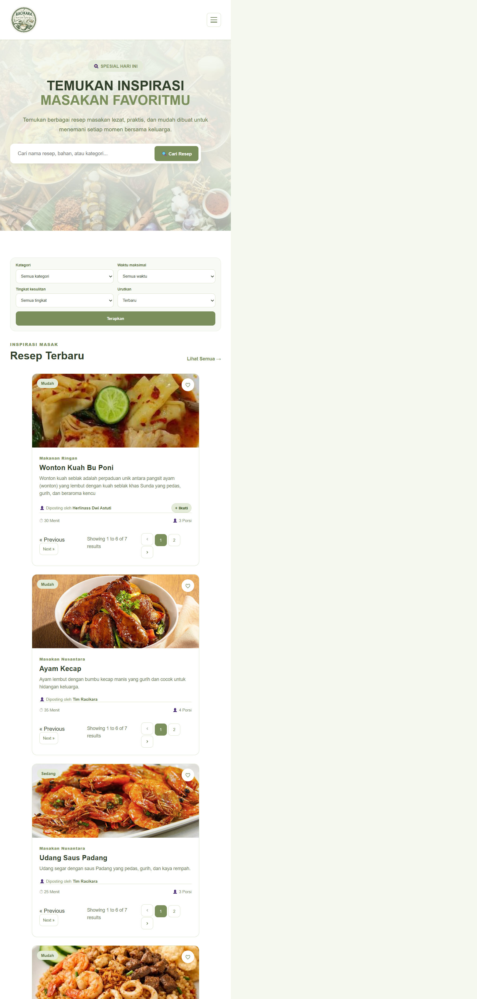
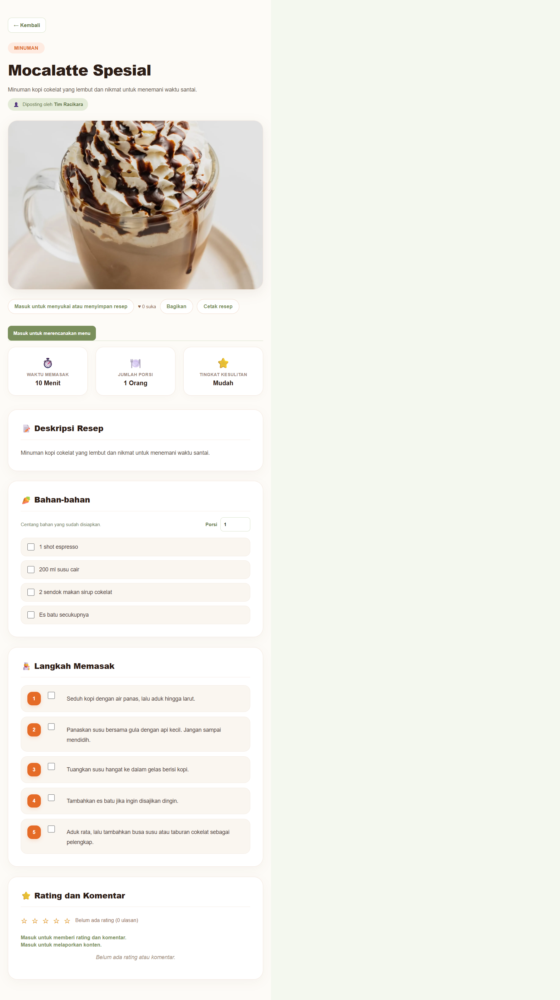
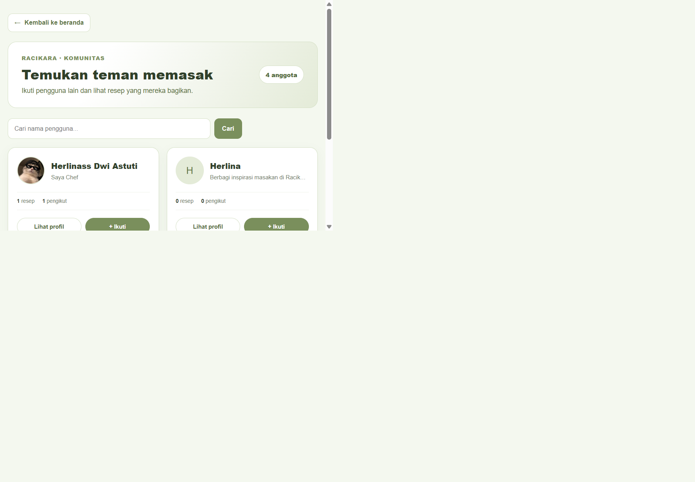
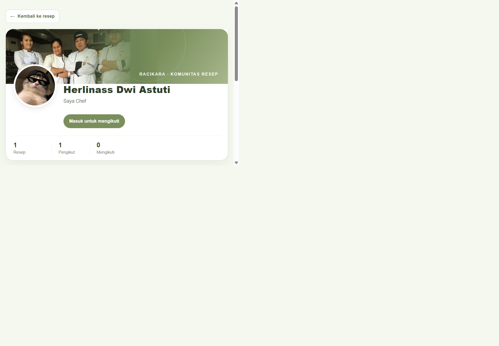
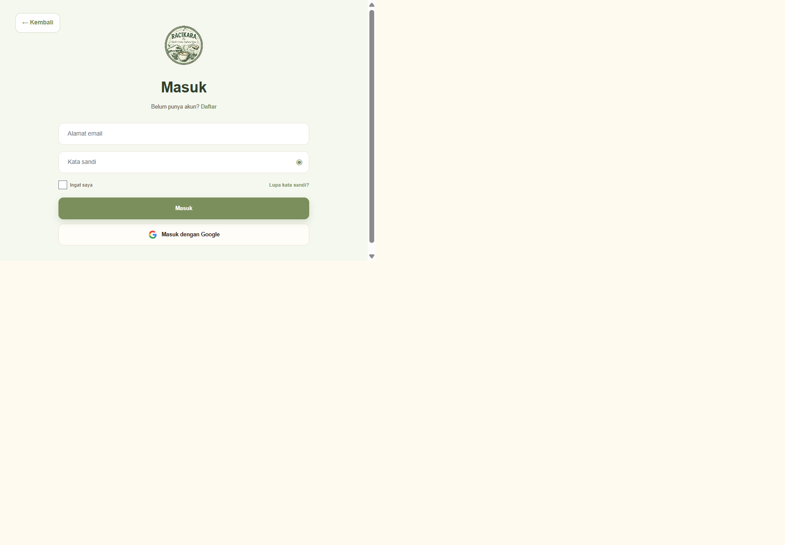
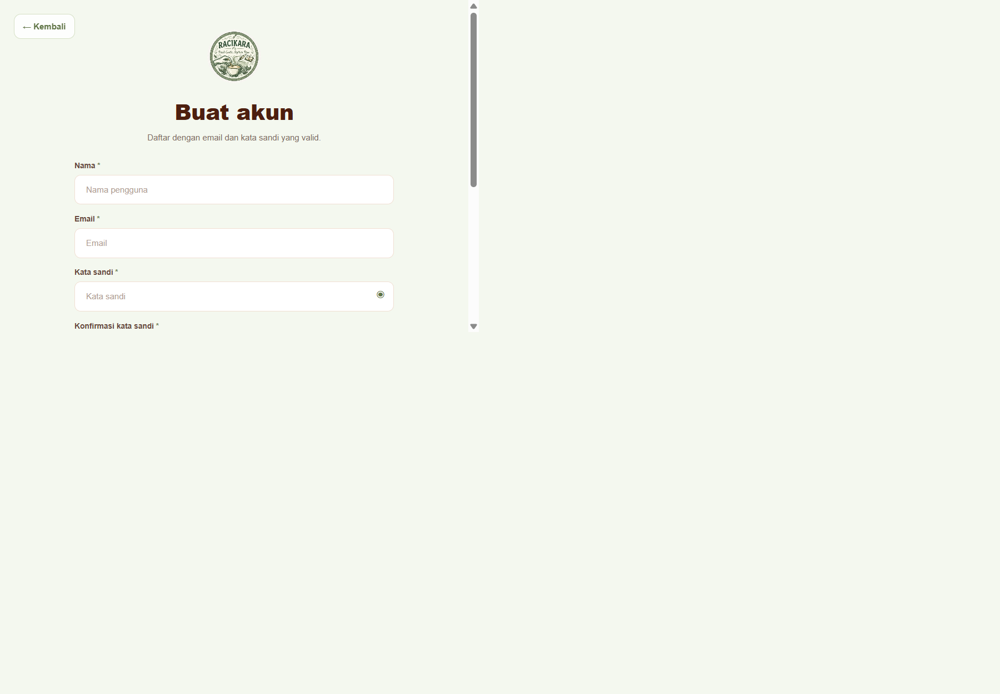
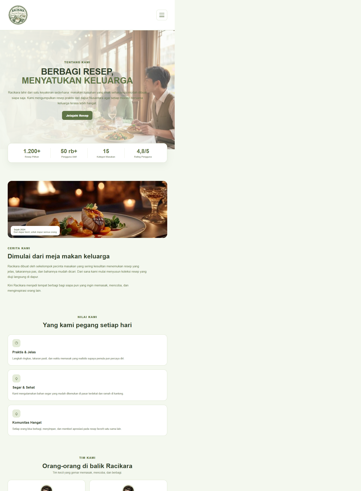

# 🍳 RACIKARA – Sistem Informasi Resep Masakan

**Racikara** adalah aplikasi berbasis website yang menyediakan informasi berbagai resep masakan. Aplikasi ini memungkinkan pengguna mencari resep, membagikan resep, menyimpan resep favorit, memberikan rating, serta berinteraksi dengan pengguna lainnya.

## 📌 Tentang Proyek

Racikara dikembangkan sebagai Sistem Informasi Resep Masakan untuk memudahkan masyarakat dalam menemukan inspirasi dan informasi mengenai berbagai jenis masakan.

## ✨ Fitur Utama

### Tangkapan Layar

Berikut beberapa tampilan Racikara dari aplikasi lokal:

<p align="center">
  
  
</p>
<p align="center">
  
  
</p>
<p align="center">
  
  
</p>
<p align="center">
  
</p>

### Pengguna (User)

- Registrasi dan login.
- Melihat dan mencari resep masakan.
- Melihat resep berdasarkan kategori.
- Membuat resep sendiri.
- Mengedit dan menghapus resep milik sendiri.
- Menyimpan resep ke favorit.
- Memberikan like pada resep.
- Memberikan rating dan komentar.
- Mengikuti pengguna lain.
- Mengelola profil pengguna.

### Administrator (Admin)

- Dashboard statistik.
- Manajemen pengguna.
- Manajemen resep.
- Manajemen kategori.
- Manajemen komentar.
- Manajemen rating.
- Manajemen laporan pengguna.
- Pengelolaan pesan masuk.
- Pengaturan sistem.

## 🛠️ Teknologi yang Digunakan

- PHP 8.1+
- Laravel 10
- MySQL
- Blade, HTML, CSS, dan JavaScript
- Tailwind CSS dan Vite

## ⚙️ Instalasi dan Konfigurasi

### 1. Clone Repository

```bash
git clone https://github.com/soloherlina65-afk/resep_makanan.git
```

### 2. Masuk ke Folder Proyek

```bash
cd resep_makanan
```

### 3. Install Dependensi

```bash
composer install
npm install
```

### 4. Salin File Environment

```powershell
Copy-Item .env.example .env
```

### 5. Generate Application Key

```bash
php artisan key:generate
```

### 6. Konfigurasi Database

Buka file `.env`, kemudian sesuaikan konfigurasi database:

```env
DB_CONNECTION=mysql
DB_HOST=127.0.0.1
DB_PORT=3306
DB_DATABASE=nama_database
DB_USERNAME=root
DB_PASSWORD=
```

Sesuaikan dengan konfigurasi MySQL lokal masing-masing. Buat databasenya terlebih dahulu, lalu isi nilai `DB_*` di `.env`.

### 7. Jalankan Migration

```bash
php artisan migrate
```

Perintah ini menerapkan migration tanpa menghapus tabel atau data yang sudah ada. Hindari `migrate:fresh` pada database yang berisi data.

### 8. Jalankan Aplikasi

Siapkan penyimpanan foto dan build aset frontend:

```bash
php artisan storage:link
npm run build
```

Kemudian jalankan Laravel:

```bash
php artisan serve
```

Buka browser:

```text
http://127.0.0.1:8000
```

Selama pengembangan, jalankan `npm run dev` di terminal terpisah untuk hot reload aset.

## 📂 Struktur Proyek

```text
resep_makanan/
├── app/
│   ├── Http/
│   └── Models/
├── database/
│   ├── migrations/
│   └── seeders/
├── public/
├── resources/
│   └── views/
├── routes/
├── storage/
├── tests/
├── .env.example
├── artisan
├── composer.json
└── README.md
```

## 🔐 Hak Akses

Racikara memiliki dua jenis pengguna:

- **User:** Diberikan otomatis saat mendaftar; dapat mengelola resep dan interaksi miliknya sendiri melalui `/dashboard`.
- **Admin:** Dapat mengelola data sistem melalui `/admin/dashboard`. Role admin tidak dapat dipilih dari formulir pendaftaran.

Untuk menjadikan akun lokal sebagai admin pertama, pilih database yang dikonfigurasi pada `DB_DATABASE` di phpMyAdmin, lalu jalankan query berikut dengan email akun yang benar:

```sql
UPDATE users
SET role = 'admin', is_admin = 1
WHERE email = 'email-akun-anda@example.com';
```

## 🧪 Pengujian

Jalankan Feature Test dengan:

```bash
php artisan test
```

## 🌐 Website

Proyek ini saat ini dijalankan secara lokal. Buka `http://127.0.0.1:8000` setelah menjalankan `php artisan serve`.

## 👩‍💻 Pengembang

**Nama Proyek:** Racikara

**Jenis Proyek:** Sistem Informasi Resep Masakan

**Framework:** Laravel

**Database:** MySQL
